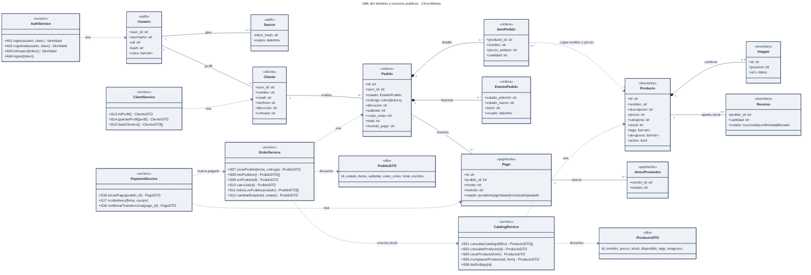
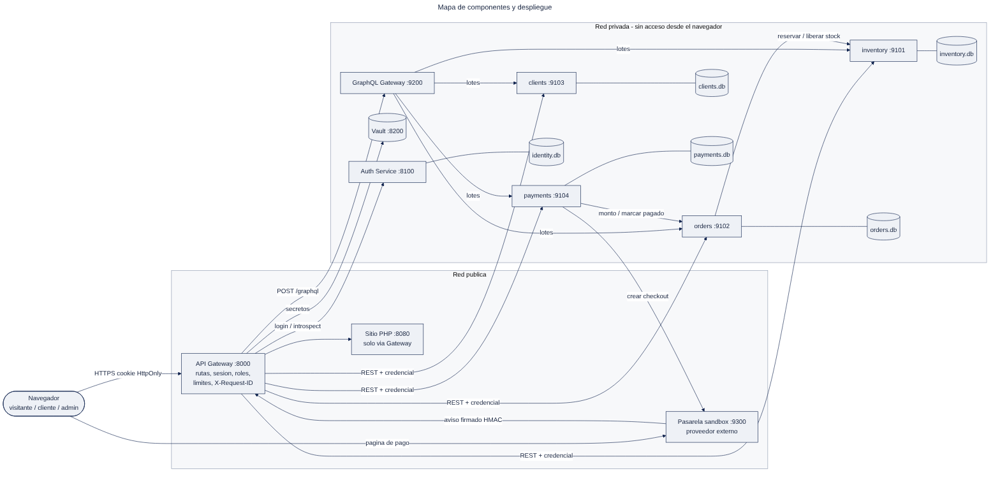
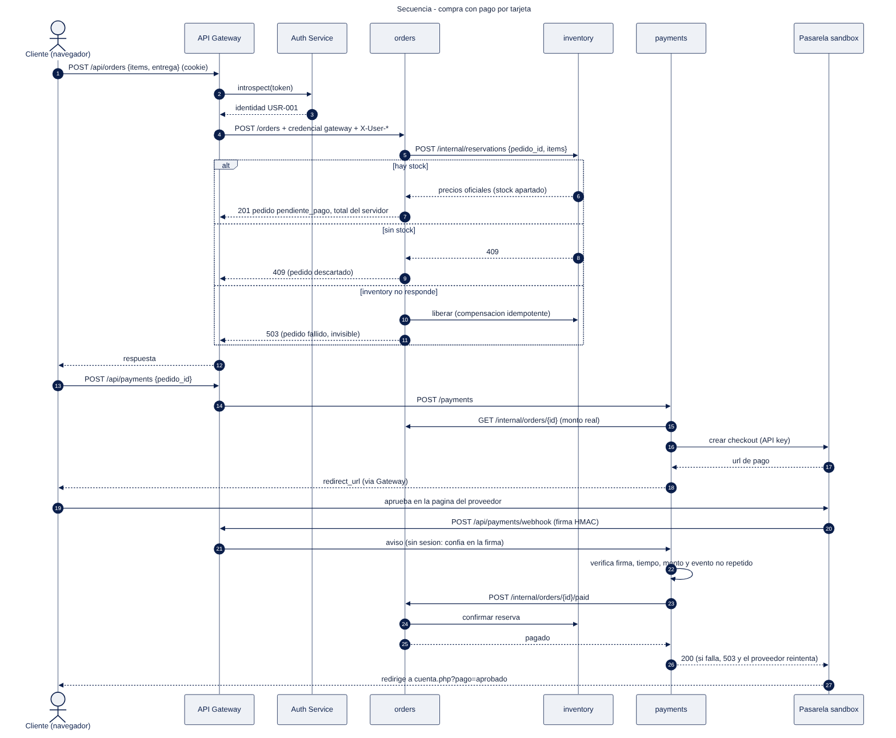
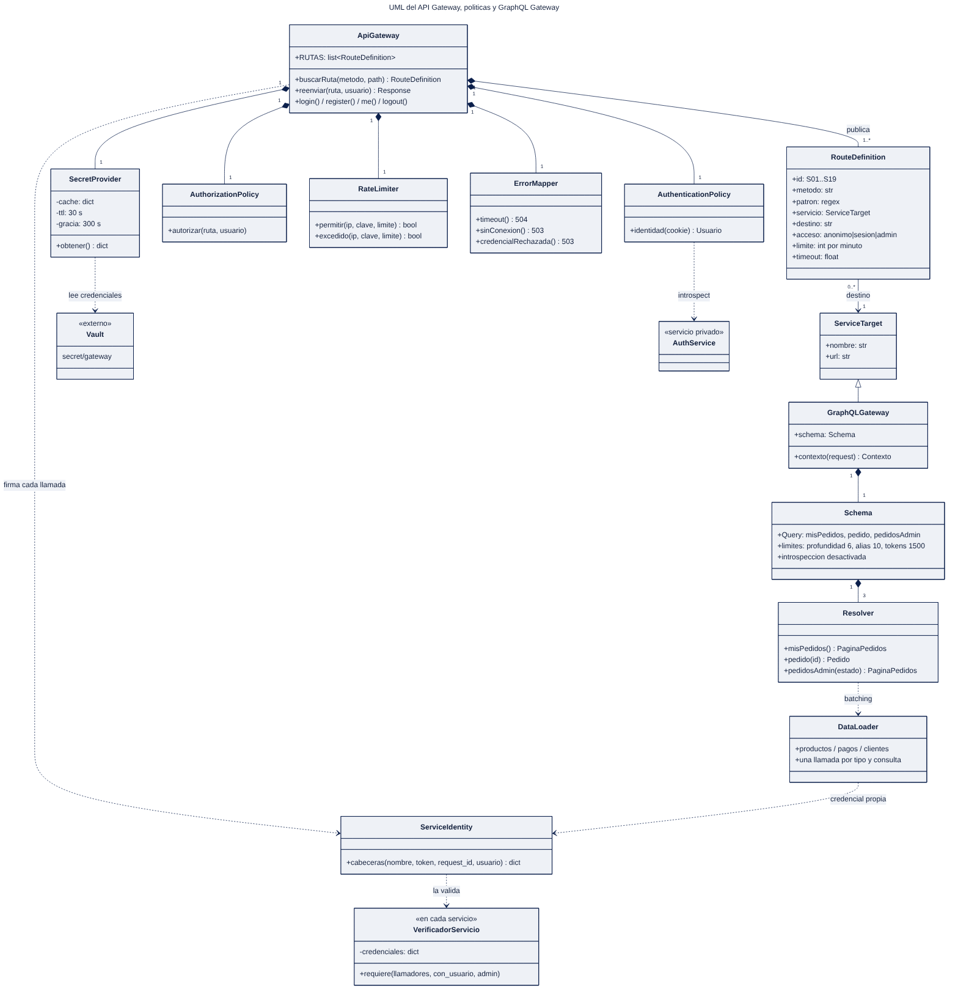

# Evaluación de la Unidad 2 — Backend seguro completo

**Desarrollo Web y Móvil · Universidad Andrés Bello**

| | |
|---|---|
| Caso de negocio | **Caso 25. Chocolatería “ChocoManía” – chocolates artesanales** |
| Integrante | Vicente Ignacio Ortega (trabajo individual) |
| Versión del frontend | Semana 13 del repositorio `Vion-958/Tienda-HTML-para-Desarrollo-Web-y-Movil` (commit `d407e89`), integrado y ajustado en esta entrega |
| Carpeta entregada | `Semana 14 - EVALUACION 2/` |
| Fecha | 9 de noviembre de 2026 |

Todo lo que describe este informe está implementado y se puede ejecutar: `python iniciar.py` levanta el sistema completo y `pytest pruebas` ejecuta **98 pruebas** (68 unitarias, 26 de integración contra el sistema real y 4 en navegador). Los diagramas están en `docs/diagramas/` en formato Mermaid (`.mmd`, editable como texto) con su versión renderizada (`.svg` / `.png`). El modelo C4 está en `docs/c4/workspace.dsl`.

---

## Requisitos del caso y brechas

### Requisitos funcionales (fuente: el caso y las pantallas del frontend)

| ID | Requisito | Pantalla |
|---|---|---|
| R01 | Ver el catálogo, filtrar por categoría, tags y búsqueda, sin iniciar sesión | P01 Catálogo |
| R02 | Ver el detalle de un producto: galería, precio, stock, ingredientes y alérgenos | P02 Producto |
| R03 | Armar un carrito y confirmar un pedido con retiro o delivery | P03 Carrito |
| R04 | Pagar el pedido con tarjeta (pasarela) o transferencia | P03 Carrito, P04 Cuenta |
| R05 | Crear una cuenta, iniciar y cerrar sesión | P04 Cuenta |
| R06 | Ver y editar los datos personales y de despacho | P04 Cuenta |
| R07 | Ver los pedidos propios con su estado y su pago, y cancelar los pendientes | P04 Cuenta |
| R08 | Solicitar una cotización de pedido especial | P05 Pedidos Especiales |
| R09 | Enviar un mensaje de contacto | P06 Sobre Nosotros |
| R10 | Administrador: agregar, modificar y dar de baja productos con imágenes | P04 Cuenta (admin) |
| R11 | Administrador: ver todos los pedidos, avanzar su estado, anularlos y confirmar transferencias | P04 Cuenta (admin) |
| R12 | Administrador: revisar y responder solicitudes de cotización y contacto | P04 Cuenta (admin) |

Escritorio y móvil usan las mismas pantallas responsivas: las variaciones visuales no generan servicios distintos.

### Brechas detectadas en el frontend de la Semana 13 y cómo se resolvieron

| Brecha | Problema | Resolución en esta entrega |
|---|---|---|
| "Confirmar y pagar" inventaba un número de pedido al azar | No había pedido real ni pago | Checkout real: `orders` crea el pedido, `payments` inicia el pago, pasarela sandbox con aviso firmado |
| El carrito pedía número de tarjeta y CVV | Datos de tarjeta en nuestro sitio, sin necesidad | Se eliminaron. La tarjeta se ingresa en la página del proveedor |
| Cupones calculados en el navegador | Un descuento del frontend no es confiable y no se enviaba al servidor | Se eliminaron del carrito. **Brecha restante:** promociones; se propone una tabla `promociones` en `orders` y que el código se valide al crear el pedido |
| Opción "Pago contra entrega" | No tenía flujo en el negocio | Se retiró; quedan tarjeta y transferencia |
| Catálogo con sesión obligatoria (Semana 9) | El visitante no podía ver productos reales | Catálogo anónimo (S01–S03) |
| Formularios de cotización y contacto solo mostraban "gracias" | No llegaban a la tienda | `clients` guarda las solicitudes (S20) y el admin las gestiona (S21–S22) |
| No existía registro de usuarios | Solo había 2 usuarios fijos | Registro con hash adaptativo (A02) y perfil en `clients` |
| Todo vivía en memoria en un único backend | No cumple persistencia ni separación | 4 microservicios, cada uno con su base SQLite, esquema y datos de prueba |

**Brechas que quedan declaradas:** recuperación de contraseña (no hay pantalla ni proveedor de correo), envío real de correos de confirmación y promociones. Ninguna bloquea los flujos de compra, pago ni administración.

---

## Servicios derivados del frontend

**Convenciones.** *Público*: se puede mostrar a cualquiera (nombre y precio de un producto). *Restringido*: dato personal o de negocio de un usuario (dirección, correo, pedidos, pagos). *Acceso*: anónimo, opcional (anónimo o con sesión), sesión o admin.

| ID | Requisito | Pantalla y acción | Propósito | Verbo y ruta | Entrada | Salida | Reglas y errores | Clasificación | Acceso |
|---|---|---|---|---|---|---|---|---|---|
| S01 | R01 | P01 → cargar catálogo, filtrar | Consultar catálogo | `GET /api/products` | `categoria`, `tag` (≤8), `q`, `disponible`, `pagina`, `tamano` (≤50) | 200 `{products[], total}` | 422 filtro inválido; solo productos activos y campos públicos | Público | Anónimo |
| S02 | R02 | P02 → abrir producto | Detalle | `GET /api/products/{id}` | id | 200 `{product}` | 404 si no existe o fue dado de baja | Público | Anónimo |
| S03 | R02 | P01/P02 → mostrar imagen subida | Imagen | `GET /api/images/{id}` | id | 200 binario JPG/PNG/WEBP | 404; `nosniff` | Público | Anónimo |
| S04 | R10 | P04 admin → "+ Agregar producto" | Crear producto | `POST /api/products` (multipart) | nombre, precio, categoría, stock, descripción, tags, ingredientes, alérgenos, 1–5 imágenes | 201 `{product}` | 400 con error por campo; nombre único; imagen validada por contenido, ≤2 MB | Público (catálogo) | Admin |
| S05 | R10 | P04 admin → "Editar" | Reemplazar producto | `PUT /api/products/{id}` (multipart) | mismos campos; imágenes opcionales | 200 `{product}` | 404; 400; sin imágenes se conservan las actuales | Público | Admin |
| S06 | R10 | P04 admin → "Eliminar" | Baja lógica | `DELETE /api/products/{id}` | id | 200 | 404; el historial de pedidos conserva nombre y precio | Público | Admin |
| S07 | R03 | P03 → "Confirmar y pagar" | Crear pedido | `POST /api/orders` | items `[{producto_id, cantidad 1–50}]` (1–30), entrega, dirección y comuna si es delivery, método de pago, nota | 201 `{order}` con subtotal, envío y total del servidor | 409 sin stock; 400 producto inexistente; 422 validación; 503 si inventory no responde | Restringido | Sesión |
| S08 | R07 | P04 → "Mis pedidos" | Listar pedidos propios | `GET /api/orders` | `pagina`, `tamano` | 200 `{orders[], total}` | Solo los del usuario | Restringido | Sesión |
| S09 | R07 | P04 → ver un pedido | Pedido propio | `GET /api/orders/{id}` | id | 200 `{order}` con eventos | 404 si es ajeno o no existe | Restringido | Sesión |
| S10 | R07 | P04 → "Cancelar" | Cancelar pedido | `POST /api/orders/{id}/cancel` | id | 200 `{order, stock_liberado}` | 409 si ya está pagado o cancelado; 404 si es ajeno | Restringido | Sesión |
| S11 | R11 | P04 admin → "Gestión de pedidos" | Todos los pedidos | `GET /api/admin/orders` | `estado`, `pagina` | 200 `{orders[]}` | — | Restringido | Admin |
| S12 | R11 | P04 admin → "Preparar / Despachar / Entregado / Anular" | Cambiar estado | `PATCH /api/admin/orders/{id}/estado` | `{estado, motivo}` | 200 `{order}` | 409 si la transición no es válida; `pagado` no se puede fijar aquí | Restringido | Admin |
| S13 | R06 | P04 → "Mis datos"; P03 → precargar contacto | Ver perfil propio | `GET /api/clients/me` | — | 200 `{client}` | 404 si aún no completa su perfil | Restringido | Sesión |
| S14 | R05, R06 | P04 → "Guardar mis datos"; P03 al confirmar; registro | Guardar perfil propio | `PUT /api/clients/me` | nombre, email, teléfono, dirección, comuna | 200 `{client}` | 409 correo de otro cliente; 422 formato | Restringido | Sesión |
| S15 | R11 | (uso interno del admin) | Listar clientes | `GET /api/admin/clients` | `pagina` | 200 `{clients[]}` | — | Restringido | Admin |
| S16 | R04 | P03 tras crear el pedido; P04 → "Pagar" | Iniciar pago | `POST /api/payments` | `{pedido_id}` | 201 `{payment, redirect_url}` o `{payment, instrucciones}` | 404 ajeno; 409 no pendiente; 503 pasarela caída; reutiliza el pago vivo | Restringido | Sesión |
| S17 | R04 | (la llama el proveedor, no una pantalla) | Aviso de pago | `POST /api/payments/webhook` | cuerpo JSON + `X-Pasarela-Firma` | 200 `{recibido, duplicado}` | 401 firma inválida o vencida; 400 monto distinto; 503 para que el proveedor reintente | Restringido | Anónimo + firma HMAC |
| S18 | R11 | P04 admin → "Confirmar transferencia" | Confirmar transferencia | `POST /api/admin/payments/{id}/confirmar` | id | 200 `{payment}` | 409 si no es transferencia | Restringido | Admin |
| S19 | R07, R11 | P04 → "Mis pedidos" y "Gestión de pedidos" | Consulta agregada | `POST /api/graphql` | `{query, variables}` | 200 `{data, errors}` | Ver *Separación privada y agregaciones GraphQL* | Restringido | Sesión |
| S20 | R08, R09 | P05 → "Enviar cotización"; P06 → "Enviar" | Enviar solicitud | `POST /api/solicitudes` | tipo, nombre, email, teléfono, asunto, fecha, cantidad, mensaje | 201 `{id, tipo, estado}` | 422 validación; fecha no pasada; 429 tras 5/min | Restringido | Opcional |
| S21 | R12 | P04 admin → "Solicitudes de clientes" | Listar solicitudes | `GET /api/admin/solicitudes` | `estado` | 200 `{solicitudes[]}` | — | Restringido | Admin |
| S22 | R12 | P04 admin → "Marcar respondida" | Cambiar estado | `PATCH /api/admin/solicitudes/{id}` | `{estado}` | 200 | 404 | Restringido | Admin |
| A01 | R05 | P04 → "Ingresar" | Iniciar sesión | `POST /auth/login` | `{username, password}` | 200 identidad + cookie HttpOnly | 401; 429 tras 10 fallos por usuario | Credencial | Anónimo |
| A02 | R05 | P04 → "Crear cuenta" | Registrarse | `POST /auth/register` | `{username, password}` | 201 identidad + cookie | 400 formato; 409 usuario existente; 429 | Credencial | Anónimo |
| A03 | R05 | Todas → saludo "Hola, …" | Usuario actual | `GET /auth/me` | cookie | 200 identidad | 401 | Restringido | Sesión |
| A04 | R05 | P04 → "Cerrar sesión" | Cerrar sesión | `POST /auth/logout` | cookie | 200 `{revoked}` | Revoca en el servidor | — | Sesión |

**Lo que envía el navegador y lo que calcula el servidor.** El navegador envía ids, cantidades, tipo de entrega y método de pago. El servidor calcula precios, subtotal, envío y total (orders con precios de inventory), decide el estado del pedido (orders) y decide si está pagado (payments, solo con un aviso firmado o la confirmación del admin). Un `total`, `precio` o `estado` enviado por el navegador se ignora: lo comprueba la prueba V07.

### Ejemplos de contrato (datos ficticios)

**S07 — crear pedido**
```json
POST /api/orders
{"items": [{"producto_id": "choco-2", "cantidad": 2}], "entrega": "delivery",
 "direccion": "Los Leones 100", "comuna": "Providencia", "metodo_pago": "tarjeta", "nota": ""}

201
{"order": {"id": 1004, "user_id": "USR-001", "estado": "pendiente_pago", "entrega": "delivery",
  "direccion": "Los Leones 100", "comuna": "Providencia", "metodo_pago": "tarjeta",
  "subtotal": 33200, "costo_envio": 0, "total": 33200, "pago_id": null,
  "items": [{"producto_id": "choco-2", "nombre": "Torta frutos del bosque", "precio_unitario": 16600, "cantidad": 2}]}}
```

**S01 — catálogo**
```json
GET /api/products?tag=individual&tamano=1
200
{"products": [{"id": "choco-4", "nombre": "Caja de cupcakes surtidos", "descripcion": "Chocolate, red velvet y limón.",
  "precio": 6500, "categoria": "Postres", "stock": 20, "disponible": true, "tags": ["individual", "para regalar"],
  "imagen": "https://images.unsplash.com/...", "imagenes": ["..."], "ingredientes": "...", "alergenos": ["gluten", "huevo", "lacteos"]}],
 "total": 7, "pagina": 1, "tamano": 1}
```

**S16 — iniciar pago**
```json
POST /api/payments  {"pedido_id": 1004}
201
{"payment": {"id": "PAY-703681AB1E30", "pedido_id": 1004, "monto": 33200, "metodo": "tarjeta", "estado": "pendiente"},
 "redirect_url": "http://127.0.0.1:9300/checkout/chk_592afecbbaca1367"}
```

**S17 — aviso del proveedor**
```json
POST /api/payments/webhook
X-Pasarela-Firma: t=1762700000,v1=3f9a…   (HMAC-SHA256 de "t.cuerpo")
{"evento_id": "evt_8c1f…", "checkout_id": "chk_592afecbbaca1367", "referencia": "PAY-703681AB1E30",
 "estado": "aprobado", "monto": 33200}
200 {"recibido": true, "duplicado": false, "estado": "aprobado"}
```

**S20 — cotización**
```json
POST /api/solicitudes
{"tipo": "cotizacion", "nombre": "Pía Soto", "email": "pia@example.com", "asunto": "Tortas por encargo",
 "fecha_requerida": "2026-12-20", "cantidad": "40 unidades", "mensaje": "Torta de 3 pisos"}
201 {"id": 1, "tipo": "cotizacion", "estado": "nueva"}
```

Los contratos no copian las tablas: por ejemplo, el navegador nunca recibe `creado_por` ni `activo` de un producto, ni el `sal` o el `hash` de un usuario, y S20 devuelve solo el número de la solicitud.

---

## Clases y cardinalidades del dominio

Diagrama: `docs/diagramas/uml_dominio.mmd` (editable) y `uml_dominio.svg`.



**Leyenda.** El estereotipo indica el sistema dueño de la clase (`«inventory»`, `«orders»`…). `«service»` marca una interfaz pública con sus operaciones y su ID de servicio. `«dto»` es lo que viaja al frontend. Las líneas continuas son asociaciones de negocio con multiplicidad en ambos extremos. El rombo negro indica composición (la parte no existe sin el todo). Las flechas punteadas `..>` son dependencias de uso: un servicio usa una clase o un contrato, sin que exista un registro por cada instancia.

### Relaciones y su regla de negocio

| Origen | Destino | Multiplicidad | Tipo | Regla que la justifica |
|---|---|---|---|---|
| Usuario | Sesión | 1 — 0..* | Asociación | Un usuario puede tener varias sesiones (dispositivos); cada sesión es de un usuario |
| Usuario | Cliente | 1 — 0..1 | Asociación | Recién registrado aún no tiene perfil; tiene a lo más uno. Están en sistemas distintos: auth guarda credenciales y clients los datos personales |
| Producto | Imagen | 1 — 0..5 | Composición | Hasta 5 imágenes; si se reemplazan, las anteriores se eliminan. Al crear se exige al menos 1 (regla de S04, no del modelo, porque los datos de prueba usan una URL) |
| Producto | Reserva | 1 — 0..* | Asociación | Cada pedido aparta stock de un producto; una reserva es de un producto |
| Cliente | Pedido | 1 — 0..* | Asociación | Un cliente hace muchos pedidos; cada pedido es de un cliente (`user_id`) |
| Pedido | ItemPedido | 1 — 1..* | Composición | Un pedido confirmado contiene al menos un ítem. No se modelan borradores: el carrito vive en el navegador |
| Pedido | EventoPedido | 1 — 1..* | Composición | Todo pedido nace con el evento "pendiente_pago" y suma uno por cada cambio |
| ItemPedido | Producto | 0..* — 1 | Dependencia | El ítem copia nombre y precio al comprar: si el producto cambia de precio o sale del catálogo, el historial no cambia |
| Pedido | Pago | 1 — 0..* | Asociación | Un pago rechazado permite reintentar; a lo más uno vivo (índice único parcial). Si el pedido se cancela, el pago pendiente queda `anulado` |
| Pago | AvisoProveedor | 1 — 0..* | Asociación | El proveedor puede avisar varias veces; cada `evento_id` se procesa una vez |

### Correspondencia operación UML → ID de servicio

`CatalogService`: consultarCatalogo S01, consultarProducto S02, crearProducto S04, reemplazarProducto S05, darDeBaja S06. `OrderService`: crearPedido S07, misPedidos S08, verPedido S09, cancelar S10, todosLosPedidos S11, cambiarEstado S12. `ClientService`: miPerfil S13, guardarPerfil S14, listarClientes S15 (y solicitudes S20–S22). `PaymentService`: iniciarPago S16, recibirAviso S17, confirmarTransferencia S18. `AuthService`: A01–A04.

### Decisiones del equipo

- **¿El carrito y el pedido son clases distintas?**
  Sí. El carrito es un borrador del navegador (`localStorage`, solo ids y cantidades) y no tiene valor para el servidor. El pedido nace al confirmar, con precios del servidor y al menos un ítem.
- **¿Qué pasa con el historial si un producto deja de estar disponible?**
  Nada: la baja es lógica (`activo = 0`) y `ItemPedido` guarda una copia del nombre y del precio. GraphQL igual puede mostrar la imagen porque `inventory` entrega productos inactivos por lote.
- **¿Qué se conserva internamente y qué sale en cada respuesta?**
  Internamente se guardan `sal`, `hash`, `token_hash`, `creado_por` y los bytes de las imágenes. Las respuestas usan DTO sin esos campos: `ProductoDTO` (id, nombre, precio, stock, disponible, tags, imágenes) y `PedidoDTO` (estado, ítems, totales y eventos solo en el detalle).

---

## Sistemas e integraciones

| Sistema | Responsabilidad | Datos que administra (autoridad) | Servicios | Dependencias | Contrato de integración | Credencial requerida | Respuesta ante fallos |
|---|---|---|---|---|---|---|---|
| **inventory** | Catálogo, stock, imágenes, reservas | Productos, precio oficial, stock, imágenes, reservas | S01–S06; internos: reservar, confirmar, liberar, lote | Ninguna | REST: `POST /internal/reservations` idempotente por `pedido_id`; `GET /internal/products?ids=` | Llamadores: gateway, orders, graphql (una credencial cada uno) | Transacción `BEGIN IMMEDIATE`: no vende más de lo que hay; 409 sin stock |
| **orders** | Pedidos y su ciclo de vida | Pedidos, ítems, historial de estados. **Decide el estado oficial del pedido** | S07–S12; internos: leer para pago, marcar pagado | inventory | Llama a reservar/liberar/confirmar; recibe `POST /internal/orders/{id}/paid` solo de payments | gateway, payments, graphql | Si inventory no responde: compensa liberando (idempotente), deja el pedido `fallido` invisible y responde 503 |
| **clients** | Perfil y solicitudes | Datos personales de clientes, cotizaciones, contacto | S13–S15, S20–S22; interno: perfiles por lote | Ninguna | `GET /internal/clients?ids=` filtra al propio usuario salvo admin | gateway, graphql | Si falla, GraphQL devuelve `cliente: null` con error parcial |
| **payments** | Inicio de pagos y verificación del proveedor | Pagos y avisos. **Decide si un pago está aprobado** | S16–S18; interno: pagos por lote | orders, proveedor | Lee el monto en orders; crea checkout con API key; recibe aviso HMAC; marca pagado en orders | gateway, graphql (entrada); `payments→orders` y API key del proveedor (salida) | Pasarela caída: 503 y no queda pago. Orders caído al recibir el aviso: el pago queda aprobado y no sincronizado, responde 503 y el proveedor reintenta; el reintento se reconoce como duplicado y solo sincroniza |
| Auth Service | Identidad y sesiones | Usuarios, hash de contraseñas, sesiones | A01–A04 | Ninguna | `introspect` para el Gateway | Solo gateway | Gateway responde 503; ningún servicio queda abierto |
| GraphQL Gateway | Agregación de lectura | No tiene datos propios | S19 | orders, inventory, payments, clients | Ver *Separación privada y agregaciones GraphQL* | Solo gateway; usa credencial propia hacia cada sistema | Errores parciales por campo |
| Pasarela sandbox | **Proveedor externo** (simulado) | Checkouts del proveedor | — | Gateway (aviso) | Contrato de checkout + aviso firmado | API key y secreto HMAC | Reintenta el aviso 3 veces |

Mapa de componentes: `docs/diagramas/componentes.mmd`.



Secuencia de un flujo representativo (compra con tarjeta, incluye los caminos de error): `docs/diagramas/secuencia_compra.mmd`.



### Preguntas que debe resolver el diseño

- **¿orders reserva stock o solo consulta?**
  Reserva. Consultar y después vender permite vender dos veces la última unidad. `inventory` descuenta en la misma transacción que verifica, y la reserva se libera si el pedido se cancela o falla.
- **¿Qué pasa si la respuesta de inventory no llega?**
  orders no sabe si alcanzó a reservar, así que llama a liberar (idempotente: si no había reserva, no hace nada), marca el pedido `fallido` y responde 503. El cliente reintenta con un pedido nuevo. Lo prueba `test_inventory_caido_compensa_y_503`.
- **¿Cómo se verifica el aviso del proveedor?**
  Firma HMAC-SHA256 sobre `timestamp.cuerpo` con un secreto compartido solo entre payments y el proveedor, tolerancia de 5 minutos (evita repetir avisos antiguos) y el monto debe coincidir con el pago.
- **¿Cómo se evita procesar dos veces una notificación?**
  `avisos_proveedor.evento_id` es clave primaria, el pago tiene un solo estado vivo y `orders` acepta el mismo `pago_id` de forma idempotente.
- **¿Quién autoriza el cambio a pagado?**
  Solo `payments`, con su credencial: la ruta interna rechaza a cualquier otro llamador (403) y el PATCH del admin no permite fijar `pagado`.
- **¿Qué pasa si el cliente cancela el pedido con un pago en curso?**
  Antes de aprobar, `payments` consulta el estado del pedido en `orders`. Si está cancelado, el pago queda `anulado`: el admin no puede confirmar la transferencia (409) y un aviso aprobado del proveedor se registra como anulado para reembolso, sin reintentos. GraphQL muestra como anulado el pago pendiente de un pedido cancelado. Lo prueban `test_transferencia_de_pedido_cancelado_se_anula` y `test_aviso_aprobado_de_pedido_cancelado_se_anula`.

---

## Stakeholders y permisos HTTP

### Registro de stakeholders

| Stakeholder | Interés | Rol o identidad | Uso de la información |
|---|---|---|---|
| Visitante | Ver productos y precios, pedir cotización | Anónimo | Catálogo público; envía solicitudes |
| Cliente | Comprar, pagar y seguir sus pedidos | Rol `user` | Sus pedidos, pagos y perfil |
| Administrador de la tienda | Mantener el catálogo y despachar | Rol `admin` | Catálogo, pedidos, pagos, solicitudes |
| Proveedor de pagos | Cobrar y avisar el resultado | Identidad técnica: firma HMAC | Envía avisos; recibe monto y referencia |
| Servicios internos | Colaborar entre sí | Identidades técnicas: gateway, orders, payments, graphql | Solo las rutas internas permitidas |
| Dueña del negocio | Ventas y estado del negocio | **Sin permisos operativos** | Recibe un reporte del admin (pedidos por estado desde "Gestión de pedidos") |
| Repartidor / delivery | Saber qué entregar | **Sin permisos operativos** | El admin le entrega la dirección del pedido despachado; no accede al sistema |
| Docente / evaluador | Revisar la solución | **Sin permisos operativos** | Usa las cuentas de prueba y el repositorio |

### Matriz de permisos (por servicio, ruta, verbo y condición)

| Rol o identidad | ID | Ruta | Verbo | Decisión | Alcance y condición | Dónde se verifica |
|---|---|---|---|---|---|---|
| Visitante | S01–S03 | `/api/products`, `/api/images/*` | GET | Permitido | Solo productos activos y campos públicos | Gateway (ruta anónima) + inventory |
| Visitante | S04–S06 | `/api/products` | POST, PUT, DELETE | Denegado (401) | — | Gateway |
| Visitante | S20 | `/api/solicitudes` | POST | Permitido | 5 por minuto por IP | Gateway (límite) + clients (validación) |
| Visitante | S07–S19 | pedidos, perfil, pagos, GraphQL | todos | Denegado (401) | — | Gateway |
| Cliente | S07 | `/api/orders` | POST | Permitido | El pedido queda a su nombre (`user_id` del Gateway, nunca del cuerpo) | orders |
| Cliente | S08, S09 | `/api/orders`, `/api/orders/{id}` | GET | Permitido | **Solo pedidos propios**; un pedido ajeno responde 404 | orders |
| Cliente | S10 | `/api/orders/{id}/cancel` | POST | Permitido | Propio y en `pendiente_pago`; pagado → 409 | orders |
| Cliente | S11, S12 | `/api/admin/orders…` | GET, PATCH | Denegado (403) | — | Gateway y orders |
| Cliente | S13, S14 | `/api/clients/me` | GET, PUT | Permitido | Solo su propio perfil (no hay id en la ruta) | clients |
| Cliente | S16 | `/api/payments` | POST | Permitido | Pedido propio y pendiente; monto de orders | payments |
| Cliente | S04–S06, S15, S18, S21, S22 | administración | todos | Denegado (403) | Consultar el catálogo no otorga administración | Gateway y cada servicio |
| Cliente | S19 | `/api/graphql` | POST | Permitido | `misPedidos` y `pedido` propios; `pedidosAdmin` → error | GraphQL + orders |
| Administrador | S04–S06 | `/api/products…` | POST, PUT, DELETE | Permitido | Baja lógica; validación completa | Gateway + inventory (re-verifica rol) |
| Administrador | S09, S11, S12 | pedidos | GET, PATCH | Permitido | Solo transiciones válidas; no puede fijar `pagado` | orders |
| Administrador | S18 | `/api/admin/payments/{id}/confirmar` | POST | Permitido | Solo pagos por transferencia | payments |
| Administrador | S15, S21, S22 | clientes, solicitudes | GET, PATCH | Permitido | — | Gateway + clients |
| Proveedor | S17 | `/api/payments/webhook` | POST | Permitido | Firma válida, ≤5 min, monto correcto, evento no repetido | payments |
| Cualquier rol | — | `/api/internal/*` o rutas no listadas | todos | No existe (404) | El Gateway solo publica su tabla | Gateway |
| payments | — | `/internal/orders/{id}/paid` (interna) | POST | Permitido | Solo payments | orders |
| orders | — | `/internal/reservations…` (interna) | POST | Permitido | Solo orders | inventory |
| Cualquier otro llamador | — | servicios internos | todos | Denegado (403) | Sin credencial de servicio válida | Cada servicio |

PUT reemplaza la representación completa (S05, S14). PATCH se usa para cambios parciales de estado (S12, S22). La anulación de un pedido no borra el registro: queda en estado `cancelado` con su historial (`pedido_eventos`) y el stock vuelve al catálogo.

**Identidad y autorización.** La identidad la establece el Auth Service (cookie → introspección). La autorización se aplica en dos capas: el Gateway por ruta y rol, y cada servicio por recurso (propiedad, estado, rol). Ocultar un botón en el frontend no autoriza nada: la prueba V03 llama directo a las rutas de admin con la cuenta de un cliente.

---

## Clases del API Gateway

Diagrama: `docs/diagramas/uml_gateway.mmd` / `uml_gateway.svg`.



Relaciones estructurales: `ApiGateway «1» — «1..*» RouteDefinition`, porque cada definición pertenece al único gateway, y composición con sus políticas, el limitador, el mapeador de errores y el proveedor de secretos. Dependencias de comunicación (punteadas): con Auth Service para la introspección, con Vault para las credenciales y con `ServiceIdentity`, que firma cada llamada. El `GraphQLGateway` es un `ServiceTarget` más, con `Schema`, `Resolver` y `DataLoader`. El mapa de componentes de *Sistemas e integraciones* muestra los flujos de red; este UML muestra la estructura.

### Decisiones

- **¿Uno o varios gateways?**
  Uno solo. Las rutas públicas, autenticadas y administrativas se separan con políticas en la misma tabla (`acceso`, `limite`, `timeout`). Un segundo gateway solo se justificaría con otro tipo de cliente (por ejemplo, una app móvil con otro esquema de autenticación) o con requisitos de escala distintos, y el caso no tiene ninguno de los dos. El GraphQL Gateway no es un segundo punto de entrada: es privado y solo lo alcanza el API Gateway.
- **¿Qué valida el gateway y qué valida cada sistema?**
  El gateway valida que la ruta exista, la sesión, el rol mínimo, el límite de solicitudes, el tamaño del cuerpo (12 MB) y el tiempo de espera. Además descarta las cabeceras del navegador. Cada sistema valida la credencial del llamador, el usuario propagado, la propiedad del recurso, las transiciones de estado y el formato de los datos. Un servicio interno rechaza (403) cualquier llamada sin credencial válida aunque venga de la red interna.

### Fronteras de confianza

1. **Internet → Gateway.** Nada del navegador es confiable: la cookie se verifica con el Auth Service y las cabeceras `X-User-*`, `X-Service-*` y `X-Request-ID` que mande el navegador se descartan.
2. **Gateway → servicios.** Cada llamada lleva la credencial propia del par gateway→servicio, leída de Vault, y la identidad ya verificada.
3. **Servicio → servicio.** Cada flecha tiene su credencial. `orders` solo puede llamar a inventory, y `payments` solo a orders. La identidad de usuario solo se acepta si viene del gateway o de graphql.
4. **Proveedor → Gateway.** Ruta pública: la confianza viene de la firma HMAC, no de la red.

### Recorrido de una solicitud autorizada y una denegada

Diagrama: `docs/diagramas/secuencia_autorizada_denegada.mmd`.

- **Autorizada.** Ana pide `GET /api/orders/1003`. El Gateway encuentra la ruta S09, aplica el límite, hace la introspección (USR-001, rol user) y llama a orders con su credencial y `X-User-Id: USR-001`. orders comprueba que el pedido es de USR-001 y responde 200.
- **Denegada por propiedad.** Ana pide `GET /api/orders/1002` y agrega `X-User-Roles: admin`. El Gateway descarta esa cabecera y envía `USR-001`; orders responde 404 sin datos.
- **Denegada por rol.** Ana pide `DELETE /api/products/choco-1`. La ruta S06 exige admin, así que el Gateway responde 403 y la solicitud no llega a inventory.

El ZIP de apoyo del curso (`apigateway.zip`) se usó para reconocer el flujo cookie → introspección → backend con secreto. Esta entrega lo extiende: hay credenciales por destino en lugar de un secreto compartido, una tabla explícita en lugar de una redirección genérica, cuatro sistemas separados, límites, timeouts y mapeo de errores.

---

## Rutas y secretos de integración

### Matriz de rutas

Gateway externo único. Credencial = referencia simbólica, nunca el valor.

| ID | Verbo | Ruta externa | Acceso y rol | Sistema y ruta destino | Controles | Referencia de credencial |
|---|---|---|---|---|---|---|
| S01 | GET | `/api/products` | Anónimo | inventory `GET /products` | Filtros validados, `tamano` ≤ 50, 120/min | `gateway-inventory` |
| S02 | GET | `/api/products/{id}` | Anónimo | inventory `GET /products/{id}` | id `[A-Za-z0-9_-]{1,40}` | `gateway-inventory` |
| S03 | GET | `/api/images/{id}` | Anónimo | inventory `GET /images/{id}` | 600/min, `nosniff` | `gateway-inventory` |
| S04 | POST | `/api/products` | Admin | inventory `POST /products` | 30/min, 15 s, 12 MB, imagen por contenido | `gateway-inventory` |
| S05 | PUT | `/api/products/{id}` | Admin | inventory `PUT /products/{id}` | ídem | `gateway-inventory` |
| S06 | DELETE | `/api/products/{id}` | Admin | inventory `DELETE /products/{id}` | 30/min | `gateway-inventory` |
| S07 | POST | `/api/orders` | Sesión | orders `POST /orders` | 20/min, 8 s | `gateway-orders` (+ `orders-inventory`) |
| S08 | GET | `/api/orders` | Sesión | orders `GET /orders` | Paginación ≤ 50 | `gateway-orders` |
| S09 | GET | `/api/orders/{id}` | Sesión | orders `GET /orders/{id}` | id numérico; propiedad | `gateway-orders` |
| S10 | POST | `/api/orders/{id}/cancel` | Sesión | orders `POST /orders/{id}/cancel` | 20/min | `gateway-orders` |
| S11 | GET | `/api/admin/orders` | Admin | orders `GET /admin/orders` | — | `gateway-orders` |
| S12 | PATCH | `/api/admin/orders/{id}/estado` | Admin | orders `PATCH /admin/orders/{id}/estado` | Transiciones | `gateway-orders` |
| S13 | GET | `/api/clients/me` | Sesión | clients `GET /clients/me` | — | `gateway-clients` |
| S14 | PUT | `/api/clients/me` | Sesión | clients `PUT /clients/me` | 20/min | `gateway-clients` |
| S15 | GET | `/api/admin/clients` | Admin | clients `GET /admin/clients` | Paginación | `gateway-clients` |
| S16 | POST | `/api/payments` | Sesión | payments `POST /payments` | 20/min, 8 s | `gateway-payments` (+ `payments-orders`, `pasarela-api-key`) |
| S17 | POST | `/api/payments/webhook` | Anónimo + firma | payments `POST /payments/webhook` | 60/min, cuerpo ≤ 4 KB, solo reenvía `X-Pasarela-Firma` | `gateway-payments` + `pasarela-webhook` |
| S18 | POST | `/api/admin/payments/{id}/confirmar` | Admin | payments `POST /admin/payments/{id}/confirmar` | 30/min | `gateway-payments` (+ `payments-orders`) |
| S19 | POST | `/api/graphql` | Sesión | graphql `POST /graphql` | 60/min, límites de GraphQL | `gateway-graphql` (+ `graphql-*`) |
| S20 | POST | `/api/solicitudes` | Opcional | clients `POST /solicitudes` | 5/min | `gateway-clients` |
| S21 | GET | `/api/admin/solicitudes` | Admin | clients `GET /admin/solicitudes` | — | `gateway-clients` |
| S22 | PATCH | `/api/admin/solicitudes/{id}` | Admin | clients `PATCH /admin/solicitudes/{id}` | — | `gateway-clients` |
| A01 | POST | `/auth/login` | Anónimo | auth `POST /login` | 10 fallos/min por usuario y 50 por IP → 429 | `gateway-auth` |
| A02 | POST | `/auth/register` | Anónimo | auth `POST /register` | 5/min | `gateway-auth` |
| A03 | GET | `/auth/me` | Sesión | auth `POST /introspect` | — | `gateway-auth` |
| A04 | POST | `/auth/logout` | Sesión | auth `POST /logout` | Borra la cookie | `gateway-auth` |

**Transformación.** El prefijo `/api` se quita, los ids pasan por expresiones regulares estrictas y la ruta interna se arma desde una plantilla (`/orders/{0}/cancel`), nunca concatenando lo que manda el navegador. Las rutas `/internal/*` no se publican.

**Credencial de usuario y credencial entre sistemas.** El usuario tiene solo la cookie de sesión (token opaco). Entre sistemas viaja `X-Service-Name` + `X-Service-Token` (uno por par), más la identidad verificada en `X-User-Id`, `X-User-Name` y `X-User-Roles`. El backend comprueba la propiedad con ese `X-User-Id`, y solo lo acepta si el llamador es gateway o graphql.

### Operaciones GraphQL

| Operación | Tipo | Campos autorizados | Resolver | Subsistemas consultados | Regla |
|---|---|---|---|---|---|
| `misPedidos(pagina, tamano ≤ 20)` | Query | Pedido completo de los propios, `producto`, `pago`, `cliente` propio | `Query.mis_pedidos` | orders, inventory, payments, clients | orders filtra por `user_id` |
| `pedido(id)` | Query | Ídem, más `eventos` | `Query.pedido` | orders (+ los demás por campo) | Ajeno → `null` |
| `pedidosAdmin(estado, pagina, tamano)` | Query | Todos, más `cliente.email` y `cliente.telefono` | `Query.pedidos_admin` | orders, clients, payments, inventory | Error si no es admin (también lo verifica orders) |

No hay mutations: las escrituras quedan en las APIs REST de cada sistema, donde viven las reglas transaccionales. `POST /graphql` no autoriza todo: cada resolver propaga la identidad y cada subsistema decide.

**gRPC: no aplica** (ADR en *Analítica y gRPC*), por eso no hay métodos gRPC que documentar.

### Inventario de secretos

| Referencia | Tipo | Emisor | Consumidor | Finalidad | Ubicación segura | Alcance | Rotación y revocación |
|---|---|---|---|---|---|---|---|
| `gateway-auth` | Credencial de servicio | `iniciar.py` (Vault local) | Gateway → Auth | Login, introspección, logout | Vault `secret/gateway.auth`; Auth por variable de entorno | Solo Auth | Nueva en cada arranque; cambiarla en Vault invalida la anterior |
| `gateway-inventory` / `-orders` / `-clients` / `-payments` / `-graphql` | Credencial de servicio | ídem | Gateway → cada servicio | Reenviar solicitudes | Vault `secret/gateway.*` | Un solo servicio cada una | Ídem. El Gateway relee Vault cada 30 s |
| `orders-inventory` | Credencial de servicio | ídem | orders → inventory | Reservar, confirmar, liberar | Variable de entorno de orders | Solo rutas de reservas y lotes | Arranque |
| `payments-orders` | Credencial de servicio | ídem | payments → orders | Leer monto, marcar pagado | Variable de entorno de payments | Solo `/internal/orders/*` | Arranque |
| `graphql-orders` / `-inventory` / `-payments` / `-clients` | Credencial de servicio | ídem | GraphQL → cada servicio | Lecturas agregadas | Variable de entorno de graphql | Solo lecturas | Arranque |
| `pasarela-api-key` | API key del proveedor | Proveedor | payments | Crear checkouts | Variable de entorno de payments (Vault en producción) | Solo crear cobros | Panel del proveedor |
| `pasarela-webhook` | Secreto HMAC | Proveedor | payments | Verificar avisos | Ídem | Solo verificar firmas | Panel del proveedor; se aceptarían dos secretos durante el cambio |
| `vault-token` | Token de Vault | `iniciar.py` / `.env` | Gateway | Leer `secret/gateway` | Variable de entorno del Gateway | Solo lectura de esa ruta (en producción, con política) | Arranque |
| Base de datos SQLite | Archivo | Cada servicio | Solo su servicio | Persistencia | `servicios/<s>/data/` (en `.gitignore`) | El servicio que la usa | — |

No se reutiliza la misma credencial entre sistemas: si se filtra `graphql-orders`, permite leer pedidos con identidad propagada, pero no marcar pagos (solo `payments-orders` puede hacerlo) ni reservar stock.

**Si una clave se filtra.** Se rota en su origen. En el modo local basta con reiniciar `iniciar.py`, que genera todas de nuevo; en Docker se cambia `.env` o Vault y se reinicia el servicio afectado. Los logs no contienen secretos (prueba V12), así que no hay que limpiarlos.

**Si Vault no responde.** El Gateway sigue con la última lectura hasta 5 minutos y después responde 503 (falla cerrada, no abierta).

No hay secretos en rutas, query strings, el repositorio, capturas ni logs. En producción, todas las comunicaciones irían por TLS (la cookie ya admite `Secure` con `COOKIE_SECURE=true`).

---

## Datos sensibles y secretos del cliente

| Dato o credencial | Finalidad | Clasificación | Sistema custodio | Roles autorizados | Representación en el frontend | Protección | Retención |
|---|---|---|---|---|---|---|---|
| Nombre, descripción, precio, stock, imágenes de producto | Vender | Público | inventory | Todos | Catálogo | Solo campos permitidos | Mientras exista el producto; la baja es lógica |
| Usuario (nombre de login) | Identificar la cuenta | Restringido | auth | El propio | "Hola, ana" | — | Mientras exista la cuenta |
| Contraseña | Autenticar | **Credencial** | auth | Nadie la lee | Campo `password`, nunca se devuelve | PBKDF2-SHA256, 200.000 iteraciones, sal aleatoria por usuario; comparación en tiempo constante | Solo el hash |
| Token de sesión | Mantener la sesión | **Credencial** | auth | — | No visible: cookie HttpOnly, SameSite=Lax | En la base solo `sha256(token)`; vence a los 30 min; logout lo revoca | Se borra al vencer o al cerrar sesión |
| Nombre completo, correo, teléfono | Contactar y despachar | Personal restringido | clients | Dueño; admin para despacho | "Mis datos", precarga del checkout | Solo `/clients/me`; correo único | Mientras exista la cuenta |
| Dirección y comuna | Despacho | Personal restringido | clients (perfil) y orders (copia en el pedido) | Dueño del pedido y admin | Checkout y pedido | No aparece en el catálogo ni en listados públicos | Copia en el pedido para el historial de despacho |
| Pedidos e ítems | Comprar | Restringido | orders | Dueño y admin | "Mis pedidos" | Propiedad en orders; ajeno → 404 | Historial permanente (anular no borra) |
| Pagos | Cobrar | Restringido | payments | Dueño (lectura) y admin | Estado del pago | El monto sale del servidor; nunca hay datos de tarjeta | Permanente (contabilidad) |
| Datos de tarjeta | Pagar | — | **Ninguno de nuestros sistemas** | — | Se ingresan en la página del proveedor | Se eliminaron del carrito | No se almacenan |
| Solicitudes (cotización/contacto) | Responder al cliente | Personal restringido | clients | Admin | Formularios P05/P06 | Al navegador vuelve solo el número | Se propone borrar a los 12 meses |
| API key y secreto HMAC del proveedor | Integrar pagos | **Secreto de integración** | payments | — | Nunca | Variables de entorno / Vault | Rotación en el panel del proveedor |
| Credenciales entre servicios | Autenticar sistemas | **Secreto de integración** | Vault / entorno | — | Nunca | Una por par; generadas al arrancar | Cada arranque |

### Decisión sobre secretos del cliente

**No.** El sistema no custodia secretos asociados al cliente más allá de su contraseña (como hash) y su sesión (como hash del token). No guarda tarjetas ni tokens de pago reutilizables: cada pago es un checkout de un solo uso en el proveedor. Los datos personales (correo, dirección) son restringidos, pero no son claves: se protegen con control de acceso, no con cifrado reversible. Un navegador no puede mantener confidencial una clave compartida, y por eso el frontend no tiene ninguna: el JavaScript no ve ni la cookie.

### Recorrido de un dato restringido: la dirección de despacho

1. El cliente la escribe en el checkout (P03), que viaja por HTTPS a `PUT /api/clients/me`.
2. clients valida largo y formato y la guarda en su perfil, en `clients.db`.
3. Al crear el pedido, viaja a `POST /api/orders` y orders guarda una copia en el pedido, porque la dirección de ese despacho no debe cambiar si el cliente edita su perfil después.
4. Solo la ven el dueño (`/clients/me`, `misPedidos`) y el admin (`pedidosAdmin`), que la usa para despachar. No aparece en el catálogo, en S20 ni en los logs (los logs registran solo método, ruta, código e ids).
5. Conservación justificada: la copia del pedido se mantiene como respaldo del despacho. El perfil se borraría al cerrar la cuenta (eliminación de cuenta propuesta como mejora; hoy se hace a mano en la base).

### Casos de validación ejecutados contra el backend

Archivo `pruebas/integracion/test_seguridad.py`, contra el sistema real levantado por la prueba. Los 12 casos pasan.

| Caso | Entrada | Identidad | Resultado esperado y obtenido | Lo verifica |
|---|---|---|---|---|
| V01 Acceso anónimo al catálogo | `GET /api/products` | Anónimo | 200, sin campos internos | Gateway + inventory |
| V02 Operación protegida sin sesión | Pedidos, perfil, pago, GraphQL | Sin cookie | 401 | Gateway |
| V03 Administración sin permiso | Eliminar o crear producto, ver todos los pedidos, confirmar pago, `pedidosAdmin` | ana (user) | 403 / error GraphQL | Gateway, GraphQL |
| V04 Pedido ajeno | `GET/cancel /api/orders/1002`, GraphQL `pedido(1002)`, pagar 1002 | ana | 404 o `null`, sin datos | orders, payments |
| V05 Acceso directo al backend | Llamada a los 6 servicios internos con credencial adivinada y `X-User-Roles: admin` | Ninguna válida | 403 | Cada servicio |
| V06 Cabeceras de identidad falsas | `X-User-Id: USR-003`, `X-User-Roles: admin` | ana | 403 y 404 | Gateway (las descarta) |
| V07 Pago con datos alterados del frontend | Pedido con `total: 1, estado: pagado`; aviso con firma falsa | ana | Total 4.800 del servidor, estado pendiente, aviso 401, pedido sigue pendiente | orders, payments |
| V08 Fuerza bruta de login | 11 fallos seguidos | Anónimo | 10 × 401 y luego 429; otro usuario entra igual | Gateway |
| V09 Rutas internas | `/api/internal/*` | ana | 404 | Gateway |
| V10 Cookie | Login | ana | HttpOnly, SameSite=Lax, el token no aparece en el cuerpo | Gateway |
| V11 Logout revoca | Reusar la cookie después del logout | Token robado | 401 | Auth |
| V12 Logs sin secretos | Buscar todas las credenciales y la cookie en los logs | — | Ninguna aparece; hay `rid=` de correlación | Todos |

También se prueban casos unitarios: aviso con firma vencida, aviso con monto distinto, archivo `.png` que no es imagen, llamador no confiable con identidad falsa y registro con contraseña débil.

---

## Separación privada y agregaciones GraphQL

### Mapa de clasificación

| Servicio | Naturaleza | Responsabilidad | Datos propios | Contrato | Dependencias | Justificación de la separación |
|---|---|---|---|---|---|---|
| inventory | Transaccional | Catálogo y stock | inventory.db | REST | — | Cambia por razones del catálogo; es el más leído; autoridad del precio |
| orders | Transaccional | Ciclo de vida del pedido | orders.db | REST | inventory | Reglas de transición propias; consistencia del stock vía reservas |
| clients | Transaccional | Datos personales | clients.db | REST | — | Aísla los datos personales: un fallo en orders no los expone |
| payments | Transaccional / integración | Cobro y proveedor | payments.db | REST + webhook | orders, proveedor | Único dueño de la credencial del proveedor; menor superficie |
| Auth Service | Identidad | Credenciales y sesiones | identity.db | REST | — | Separado de clients: las credenciales no viven con el perfil |
| GraphQL Gateway | Agregación | Lecturas combinadas | Ninguno | GraphQL | Los 4 | No decide nada de negocio |
| Analítica | — | No aplica (ADR) | — | — | — | Ver *Analítica y gRPC* |
| Alta demanda | — | No aplica (medido) | — | — | — | Ver *Analítica y gRPC* |

Cada servicio modifica solo sus datos. La colaboración ocurre por contratos explícitos (`/internal/*`) y ninguno lee la base de otro. Vault y los servicios privados no tienen ruta pública: en Docker están en una red `internal: true` y en local escuchan en `127.0.0.1` y exigen credencial.

### Schema GraphQL

Archivo `servicios/graphql-gateway/schema.graphql` (generado del código).

```graphql
type Query {
  misPedidos(pagina: Int! = 1, tamano: Int! = 10): PaginaPedidos!
  pedido(id: Int!): Pedido
  pedidosAdmin(estado: String = null, pagina: Int! = 1, tamano: Int! = 10): PaginaPedidos!
}
type Pedido {
  id: Int!  estado: String!  entrega: String!  comuna: String!  direccion: String!
  metodoPago: String!  subtotal: Int!  costoEnvio: Int!  total: Int!  creado: String!
  items: [Item!]!
  pago: Pago              # payments
  cliente: Cliente        # clients, solo dueño o admin
  eventos: [Evento!]      # solo en pedido(id)
}
type Item { productoId: String! nombre: String! cantidad: Int! precioUnitario: Int! subtotal: Int!
            producto: Producto }   # inventory
type Producto { id: String! nombre: String! imagen: String disponible: Boolean! activo: Boolean! }
type Pago { id: String! estado: String! metodo: String! monto: Int! }
type Cliente { nombre: String! email: String! telefono: String! comuna: String! }
type Evento { estadoAnterior: String estadoNuevo: String! creado: String! }
type PaginaPedidos { pedidos: [Pedido!]! total: Int! pagina: Int! }
```

**Resolvers.** `Query.mis_pedidos` / `pedido` / `pedidos_admin` llaman a orders; `Item.producto` usa un DataLoader de productos (inventory); `Pedido.pago` usa un DataLoader de pagos (payments); `Pedido.cliente` usa un DataLoader de clientes (clients). Con el batching hay **una llamada por subsistema y por consulta**, no una por ítem: la prueba `test_agrega_tres_subsistemas_con_una_llamada_por_tipo` lo verifica con 3 ítems de 2 pedidos.

### Consulta de prueba y respuesta (datos ficticios)

```graphql
{ misPedidos(tamano: 3) { total pedidos { id estado total pago { estado metodo }
    cliente { nombre comuna } items { nombre cantidad subtotal producto { imagen disponible } } } } }
```
```json
{"data": {"misPedidos": {"total": 2, "pedidos": [
  {"id": 1003, "estado": "pendiente_pago", "total": 10400, "pago": null,
   "cliente": {"nombre": "Ana Perez", "comuna": "Providencia"},
   "items": [{"nombre": "Alfajores bañados en chocolate", "cantidad": 2, "subtotal": 10400,
              "producto": {"imagen": "https://images.unsplash.com/…", "disponible": true}}]},
  {"id": 1001, "estado": "pagado", "total": 15800, "pago": {"estado": "aprobado", "metodo": "tarjeta"}, "…": "…"}]}}}
```

### Matriz de autorización GraphQL

| Campo u operación | user | admin | Dónde se aplica |
|---|---|---|---|
| `misPedidos` | Solo los propios | Solo los propios | orders (`user_id`) |
| `pedido(id)` | Propio; ajeno → `null` | Cualquiera | orders |
| `pedidosAdmin` | Error "Se requiere el rol admin" | Permitido | GraphQL + orders |
| `Pedido.cliente` (email, teléfono) | Solo el propio | Cualquiera | clients (`/internal/clients` filtra) |
| `Pedido.pago` | Solo pagos propios | Cualquiera | payments (`/internal/payments` filtra) |
| Introspección `__schema` | Desactivada | Desactivada | GraphQL (se activa con `GRAPHQL_INTROSPECCION=1` en desarrollo) |

### Límites probados

- **Identidad:** solo el API Gateway puede llamar (si no, 403).
- **Profundidad:** 6.
- **Alias:** 10 (con 12 se rechaza).
- **Tokens:** 1.500.
- **Paginación:** máximo 20 por página (con 500 se envía 20).
- **Tiempo:** 3 s por subsistema y 8 s en el Gateway.
- **Errores parciales:** si payments cae, `pago` vuelve `null`, el resto se entrega y el error aparece en `errors`.

Todo esto lo verifican las pruebas de `test_graphql.py`.

### Evidencia desde el frontend

"Mis pedidos" (`cuenta.js` → `ChocoAPI.graphql`) y "Gestión de pedidos" del admin usan esta agregación a través de `POST /api/graphql`. Las pruebas de navegador N01, N03 y N04 la ejercitan. El navegador no puede llamar a `:9200` ni a los subsistemas (V05) y no puede pedir campos que su rol no autoriza (V03).

---

## Analítica y gRPC

### Matriz de necesidades

| Característica | Valor del caso | Fuente |
|---|---|---|
| Volumen de datos | Catálogo de decenas de productos; cientos de pedidos al mes | Proyección del negocio (pastelería local) |
| Concurrencia | Pico estimado de 20 usuarios simultáneos (fechas especiales) | Proyección |
| Tamaño de mensajes | JSON < 10 KB; imágenes ≤ 2 MB solo al administrar | Medido en los contratos |
| Frecuencia | Lecturas del catálogo >> escrituras de pedidos | Proyección |
| Latencia esperada | p95 < 500 ms catálogo, < 800 ms consulta agregada, < 1 s crear pedido | Objetivo declarado |
| Streaming | No: el estado del pedido se consulta al abrir "Mis pedidos" | Requisitos R07, R11 |
| Reportes | Pedidos por estado para el admin, con filtro | R11 |

### ADR-01: no implementar gRPC

- **Contexto.** Todas las comunicaciones internas son solicitud-respuesta con mensajes chicos, entre servicios Python del mismo equipo. No hay streaming ni procesos intensivos.
- **Alternativas.** (a) gRPC unary entre orders e inventory; (b) gRPC server-streaming para el estado del pedido; (c) REST/JSON con credencial por servicio.
- **Elección.** (c) REST/JSON.
- **Consecuencias.** Un solo stack para depurar y probar, y contratos visibles con los mismos clientes HTTP. La medición muestra que REST cumple con holgura (tabla siguiente), así que gRPC no aportaría una mejora medible a esta carga: su ventaja (tipado y streaming) no responde a una necesidad del caso. Se reconsideraría si apareciera seguimiento del despacho en tiempo real (server-streaming hacia un servicio de despacho, con un adaptador SSE hacia el navegador).

### ADR-02: no implementar un servicio de analítica separado

- **Contexto.** El único reporte del caso es la lista de pedidos por estado del admin, con pocos cientos de registros al mes.
- **Alternativas.** (a) Servicio analítico con réplica de datos; (b) agregación en línea con GraphQL sobre orders.
- **Elección.** (b). Un reporte pequeño no necesita big data ni un almacén separado. La consulta `pedidosAdmin(estado)` ya combina orders, clients y payments.
- **Consecuencias.** Sin copias de datos personales en un segundo lugar. Si el volumen creciera (miles de pedidos diarios), se agregaría un servicio privado de reportes que lea eventos de pedidos pagados (la cola ActiveMQ de la Semana 13 ya existe para eso) y que GraphQL consulte por una API interna.

### Prueba de carga

`python pruebas/carga/carga.py`: reproducible, levanta su propio sistema con bases temporales. Es una **medición**, no una proyección. Entorno: Linux, Python 3.13, 2 CPU, 8 GB, todo en una máquina. 20 usuarios concurrentes, 20 s por escenario. El límite de solicitudes del Gateway se multiplica solo durante la prueba, porque toda la carga sale de una IP.

| Escenario | Versión | Throughput (req/s) | p50 ms | p95 ms | Errores | Objetivo p95 | Cumple |
|---|---|---|---|---|---|---|---|
| Catálogo anónimo | Inicial | 65,7 | 304 | 388 | 0 % | 500 | sí |
| | **Final** | **287,4** | **62** | **121** | 0 % | 500 | **sí** |
| Mis pedidos (GraphQL, 3 subsistemas) | Inicial | 21,4 | 1.003 | 1.279 | 0 % | 800 | no |
| | **Final** | **72,1** | **264** | **395** | 0 % | 800 | **sí** |
| Crear y cancelar pedido (escritura + reserva) | Inicial | 13,3 | 1.459 | 1.807 | 0 % | 1.000 | no |
| | **Final** | **52,6** | **365** | **543** | 0 % | 1.000 | **sí** |

La primera medición no cumplía dos objetivos. El reporte de CPU mostró que el Gateway gastaba 48 s de CPU en 60 s de prueba porque abría una conexión HTTP nueva por cada llamada. Se agregó un pool de conexiones compartido en el Gateway, el GraphQL Gateway, orders y payments, y se volvió a medir. El detalle de CPU y memoria por proceso está en `docs/resultados_carga.md`. Ambas versiones se midieron con el mismo script; no se afirma una mejora sin medición.

---

## Backend completo e integración verificable

### Inicio y detención

```powershell
cd "Semana 14 - EVALUACION 2"
python -m venv .venv
.venv\Scripts\Activate.ps1
pip install -r requirements-dev.txt
python iniciar.py                    # Ctrl+C detiene todo
python iniciar.py --reiniciar-datos  # vuelve a los datos de prueba
```

Abrir **http://127.0.0.1:8000**. Usuarios de prueba: `ana / 1234` (cliente) y `ernesto / admin123` (admin). `iniciar.py` genera credenciales nuevas en cada arranque, entrega a cada proceso solo las suyas, espera el `/health` de cada uno y deja los logs en `logs/` con `rid=` de correlación. Alternativa con contenedores: `docker compose up --build` (redes pública, privada `internal` y de proveedor). El archivo está incluido, pero **el arranque verificado de esta entrega es `iniciar.py`**.

### Persistencia

Cada servicio tiene `schema.sql` (creación idempotente con `IF NOT EXISTS`, restricciones `CHECK`, claves foráneas e índices) y `seed.sql` (datos de prueba ficticios y coherentes entre servicios: las reservas de inventory corresponden a los pedidos de orders y a los pagos de payments). Las bases quedan en `servicios/<servicio>/data/` y no se suben al repositorio.

### Pruebas

```powershell
pytest pruebas/unitarias -q          # 68 pruebas, sin levantar nada
pytest pruebas/integracion -q        # 30 (26 API + 4 navegador): levanta el sistema real (deten iniciar.py antes)
playwright install chromium          # una vez, para las pruebas de navegador
python pruebas/carga/carga.py        # prueba de carga
```

Resultado de la entrega: **98 pruebas, 98 aprobadas** (salida completa en `docs/evidencias/pruebas.txt`). Capturas de los flujos principales en `docs/evidencias/`.

### Matriz requisito | pantalla | servicio | prueba | resultado

| Requisito | Pantalla | Servicios | Pruebas | Resultado |
|---|---|---|---|---|
| R01 Catálogo anónimo con filtros | P01 | S01, S03 | V01, `test_catalogo_paginado_y_filtrado` | Aprobada |
| R02 Detalle de producto | P02 | S02 | `test_crear_editar_y_baja_logica`, F08 | Aprobada |
| R03 Confirmar pedido | P03 | S07, S14 | N01, `test_total_lo_calcula_el_servidor`, `test_envio_delivery`, F04 | Aprobada |
| R04 Pagar | P03, P04 | S16, S17, S18 | N01, F01, F02, F05, `test_aviso_valido_marca_pagado_una_sola_vez`, V07 | Aprobada |
| R05 Cuenta | P04 | A01–A04, S14 | N01, F06, V08, V10, V11, `test_registro_valida_y_guarda_hash_con_sal` | Aprobada |
| R06 Mis datos | P04 | S13, S14 | F06, `test_perfil_propio` | Aprobada |
| R07 Mis pedidos y cancelar | P04 | S19, S08–S10 | N03, F03, F07, V04 | Aprobada |
| R08 Cotización | P05 | S20 | F09, `test_solicitudes_publicas_y_gestion_admin` | Aprobada |
| R09 Contacto | P06 | S20 | F09 | Aprobada |
| R10 Admin productos | P04 | S04–S06 | N04, F08, `test_validaciones`, `test_archivo_que_no_es_imagen` | Aprobada |
| R11 Admin pedidos y pagos | P04 | S11, S12, S18, S19 | N04, F05, `test_transiciones_admin` | Aprobada |
| R12 Admin solicitudes | P04 | S21, S22 | F09, `test_solicitudes_publicas_y_gestion_admin` | Aprobada |

### Ejemplo de evidencia: consulta protegida de pedido

| Ejecución | Solicitud | Resultado | Regla | Servicio |
|---|---|---|---|---|
| Autorizada | ana: `GET /api/orders/1003` | 200 con el pedido | El `user_id` del pedido es el de la sesión | orders `_propio_o_404` |
| Denegada | ana: `GET /api/orders/1002` (de ernesto) | 404 `{"detail": "Pedido no encontrado"}`, sin datos | La misma regla | orders `_propio_o_404` |

Ambas se ejecutan en `test_V04_pedido_ajeno` y en la secuencia `secuencia_autorizada_denegada.mmd`.

### Limitaciones conocidas

- **Entorno:** SQLite y una instancia por servicio son adecuados para el volumen medido, pero no para varias réplicas del mismo servicio. Para eso se migraría a PostgreSQL y el limitador del Gateway pasaría a Redis.
- **TLS:** en local se usa HTTP. En producción iría TLS en el Gateway y entre servicios, con `COOKIE_SECURE=true`.
- **Pasarela:** es un simulador con el contrato de un proveedor real. Integrar un proveedor real requiere cambiar `PASARELA_URL` y ajustar el formato del aviso.
- **Brechas declaradas en *Requisitos del caso y brechas*:** recuperación de contraseña, correos y promociones.

<div style="page-break-before: always"></div>

## Anexo — Guía de ejecución

### Requisitos

- **¿Qué hay que tener instalado?**
    Python 3.12 o superior y PHP 8 (se comprueba con `python --version` y `php -v`). No se necesita Docker, base de datos externa ni conexión a internet: cada servicio usa su propio archivo SQLite y la pasarela de pago es un simulador local.
- **¿Qué puertos usa?**
    8000 (API Gateway, la dirección que se abre en el navegador), 8080 (sitio PHP), 8100 (Auth), 8200 (Vault local), 9101–9104 (inventory, orders, clients, payments), 9200 (GraphQL) y 9300 (pasarela sandbox). Deben estar libres.

### Instalación (solo la primera vez)

- **¿Cómo se instalan las dependencias en Windows?**
    En PowerShell, desde la carpeta que contiene `Semana 14 - EVALUACION 2`, con los comandos de abajo. Si PowerShell bloquea la activación del entorno, se ejecuta una vez `Set-ExecutionPolicy -Scope CurrentUser RemoteSigned`.

```powershell
cd "Semana 14 - EVALUACION 2"
python -m venv .venv
.venv\Scripts\Activate.ps1
pip install -r requirements-dev.txt
```

- **¿Y en Linux o macOS?**
    Es igual, cambiando la activación por `source .venv/bin/activate`.
- **¿Hace falta algo más para las pruebas en navegador?**
    Sí, una sola vez: `playwright install chromium`. No es necesario para usar la página.

### Iniciar y detener

- **¿Cómo se levanta todo el sistema?**
    Con el entorno activado, `python iniciar.py`. El script genera credenciales nuevas para cada integración, inicia los diez procesos en orden y muestra `OK` junto a cada uno cuando responde. Al final aparece `ChocoMania listo en http://127.0.0.1:8000`.
- **¿Qué dirección se abre?**
    **http://127.0.0.1:8000**. Todo pasa por el API Gateway; no se debe abrir el puerto 8080 directamente, porque el sitio necesita el Gateway para el catálogo, la sesión y los pagos.
- **¿Con qué usuarios se puede entrar?**
    `ana` / `1234` (cliente) y `ernesto` / `admin123` (administrador). También se puede crear una cuenta nueva desde *Mi cuenta → Crear una cuenta*.
- **¿Cómo se detiene?**
    Con **Ctrl+C** en la terminal donde corre `iniciar.py`. Se detienen todos los procesos.
- **¿Cómo se vuelve a los datos iniciales?**
    `python iniciar.py --reiniciar-datos` borra las bases y las recrea con los datos de prueba. Sin esa opción, los pedidos, cuentas y productos creados se conservan entre ejecuciones.
- **¿Y si el sitio se sirve con XAMPP?**
    Se publica la carpeta `chocomania-frontend` en el puerto 8080 y se ejecuta `python iniciar.py --sin-php`.

### Recorrido sugerido

- **¿Qué probar como cliente?**
    Navegar el catálogo y filtrar por categoría, tags o búsqueda; crear una cuenta; agregar productos al carrito; en *Carrito*, confirmar y pagar con tarjeta: se abre la página de **SandboxPay**, donde se aprueba o rechaza el pago y se vuelve a *Mi cuenta* con el pedido actualizado. Con transferencia, el pedido queda pendiente y se puede cancelar desde *Mis pedidos* (el stock vuelve al catálogo). Los formularios de *Pedidos Especiales* y *Sobre Nosotros* llegan al administrador.
- **¿Qué probar como administrador?**
    Entrar como `ernesto`. En *Mi cuenta* aparecen *Gestión de pedidos* (preparar, despachar, entregar, anular y confirmar transferencias), *Solicitudes de clientes* y *Administración de productos* (crear con imágenes, tags y alérgenos, editar y eliminar).

### Pruebas automáticas

- **¿Cómo se ejecutan?**
    Con `iniciar.py` detenido, porque las pruebas de integración levantan su propio sistema con bases temporales:

```powershell
pytest pruebas/unitarias -q     # 68 pruebas, no necesitan nada corriendo
pytest pruebas -q               # las 98 pruebas
python pruebas/carga/carga.py   # prueba de carga -> docs/resultados_carga.md
```

### Problemas frecuentes

- **¿Qué pasa si aparece `AVISO: no se encontro 'php'`?**
    PHP no está en el PATH. Se instala PHP 8 y se agrega al PATH, o se usa XAMPP con `--sin-php`.
- **¿Qué pasa si un servicio aparece con `ERR`?**
    El script se detiene e indica qué archivo revisar en `logs/` (por ejemplo `logs/payments.log`). La causa más común es una dependencia sin instalar: se repite `pip install -r requirements-dev.txt` con el entorno activado.
- **¿Qué pasa si el login responde que la autenticación no está disponible (503), o los datos no coinciden?**
    Normalmente queda una ejecución anterior abierta ocupando los puertos. Se cierran las otras terminales de `iniciar.py` (o se reinicia el equipo) y se vuelve a ejecutar.
- **¿Por qué las imágenes de algunos productos no cargan?**
    Las fotos de los productos de prueba vienen de internet. Sin conexión, la tienda funciona igual, pero esas imágenes no se muestran.
- **¿Se puede usar Docker?**
    Sí, como alternativa: `docker compose up --build` con un archivo `.env` creado a partir de `.env.example`. El arranque verificado de esta entrega es `iniciar.py`.
