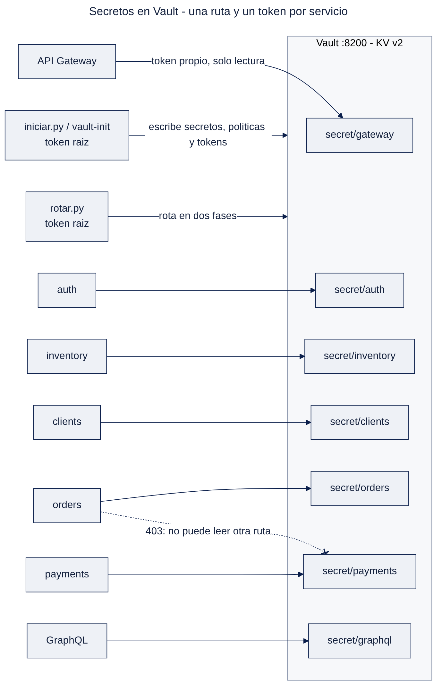
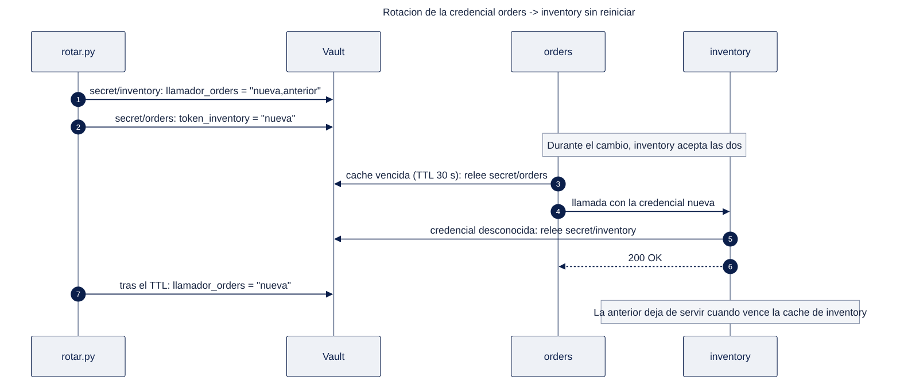

# ChocoManía — Semana 15: secretos en Vault

**Desarrollo Web y Móvil · Universidad Andrés Bello**
Vicente Ignacio Ortega · Caso 25. Chocolatería “ChocoManía” – chocolates artesanales
Revisión: lunes 23 de noviembre de 2026

---

## Objetivo

- **¿Qué se pidió para esta entrega?**
    En la reunión del 16 de noviembre se acordó aplicar la guía *API Gateway local con FastAPI y HashiCorp Vault*: que los servicios obtengan sus secretos desde Vault, el administrador de secretos, y demostrarlo con pruebas end-to-end. La encriptación de cuentas, los correos y Webpay quedaron fuera de esta entrega.
- **¿Cómo estaba antes?**
    En la Evaluación 2 solo el API Gateway leía sus credenciales desde Vault. Los otros seis servicios (auth, inventory, orders, clients, payments y GraphQL) las recibían como variables de entorno desde `iniciar.py`.
- **¿Cómo queda ahora?**
    Los siete servicios leen sus secretos desde Vault, cada uno con su propia ruta y su propio token de solo lectura. Ninguna credencial pasa por variables de entorno, y se pueden rotar con el sistema funcionando, sin reiniciar ni cambiar código.

## Qué cambió

| Archivo | Cambio |
|---|---|
| `servicios/comun/secretos.py` | **Nuevo.** Lee la ruta `secret/<servicio>` de Vault (KV v2) con caché de 30 s y 5 min de gracia si Vault no responde. Sin secretos, el servicio responde 503 controlado. |
| `servicios/comun/seguridad.py` | `VerificadorServicio` valida al llamador con las credenciales de Vault (`llamador_<origen>`). Si no reconoce una credencial, relee Vault una vez: así acepta una credencial recién rotada sin esperar la caché. |
| `servicios/*/app.py` | Cada servicio crea `Secretos("<servicio>")` y usa `secretos.get("token_<destino>")` para llamar a otros. Su `/health` informa `"vault": "ok"` o `"sin acceso"`. |
| `iniciar.py` | Levanta Vault primero; guarda los secretos; crea una política y un token de solo lectura por servicio; recién entonces inicia cada servicio con su token. Nueva opción `--vault-docker`. |
| `vault-local/vault_local.py` | Ahora acepta escrituras con versiones, políticas y creación de tokens, con la misma API HTTP de HashiCorp Vault. |
| `rotar.py` | **Nuevo.** Rota una credencial entre servicios en dos fases, sin cortes. |
| `preparar_vault.py`, `docker-compose.yml`, `.env.example` | El contenedor `vault-init` genera las credenciales y las guarda en Vault; el `.env` solo tiene tokens de Vault. |
| `pruebas/` | 24 pruebas nuevas: 11 unitarias del módulo de secretos, 9 de Vault contra el sistema real y 4 end-to-end de la cuenta de usuario en el navegador. |

## Cómo se aplica la guía

| Concepto de la guía | En ChocoManía |
|---|---|
| Secretos fuera del código (*Secret Management ≠ Hardcoded Credentials*) | Ninguna credencial está en el código, en el repositorio ni en variables de entorno. `iniciar.py` las genera al azar en cada arranque y solo existen en Vault. |
| Gateway como frontera de seguridad | Todo entra por el Gateway; los servicios rechazan con 403 a quien no presenta una credencial válida. |
| Separación de identidades: cliente y servicio | El cliente tiene su cookie de sesión. Cada par llamador → servicio tiene su propia credencial en Vault (12 en total), y el cliente nunca conoce ninguna. |
| El backend valida que la llamada viene del Gateway | `VerificadorServicio` compara la credencial recibida con la de Vault usando `secrets.compare_digest`, igual que `verify_gateway` en la guía. |
| Rotar el token sin modificar código (paso 12) | `python rotar.py orders inventory` con el sistema corriendo. La credencial anterior deja de servir sola. |
| Credenciales de Vault de privilegio mínimo (sección 21) | Cada servicio tiene una política que solo permite **leer** su ruta. El token de orders recibe 403 al intentar leer `secret/payments` o al intentar escribir. |
| Vault apagado: error controlado (matriz, fila 5) | Durante 5 minutos se usa la caché; después, 503 con `"Servicio sin acceso a sus secretos"`. Cuando Vault vuelve, los servicios se recuperan solos. |
| Restringir también la red (paso 13) | En `docker-compose.yml` los servicios están en una red `internal`; solo el Gateway y la pasarela publican puertos. |

## Diagramas

- **¿Por qué la rotación tiene dos fases?**
    Cada servicio guarda sus secretos en caché 30 segundos. Si la credencial cambiara de golpe, un servicio con la caché vieja enviaría una credencial que el otro ya no acepta, y fallarían compras en ese intervalo. Por eso, primero el servicio que recibe la llamada acepta la nueva y la anterior; cuando todos refrescaron, se elimina la anterior. La prueba S05 hace compras continuas durante la rotación y verifica que ninguna falle.
- **¿Qué guarda cada ruta?**
    `llamador_<origen>`: las credenciales que el servicio acepta. `token_<destino>`: las que usa para llamar a otro servicio. `secret/payments` guarda además las claves de la pasarela de pago. La pasarela simula un proveedor externo, así que tiene sus propias claves fuera de nuestro Vault.

## Matriz de pruebas de la guía

| N° | Prueba de la guía | Esperado en la guía | En ChocoManía | Prueba |
|---|---|---|---|---|
| 1 | Gateway sin token | 401 | 401 | V02 |
| 2 | Gateway con token falso | 401 | 401 con una cookie revocada o inventada | V11, N06 |
| 3 | Gateway con token válido | 200 | 200, compra completa | F01, N01 |
| 4 | Acceso directo al backend sin secreto | 403 | 403 en los seis servicios internos | V05 |
| 5 | Vault apagado | 500 controlado | Caché durante la gracia y luego **503** controlado; se recupera solo | S07 |
| 6 | Backend apagado | 502 | **503** controlado; el resto de la tienda sigue funcionando | S09 |
| 7 | Rotación del token en Vault | 401/200 | La nueva sirve y la anterior recibe 403, sin cortes | S05, S06 |
| 8 | Secreto interno incorrecto | 403 | 403 | V05, `test_verificador_rechaza` |
| — | Privilegio mínimo en Vault | — | Cada token lee solo su ruta y nadie escribe | S01, S02 |
| — | Credenciales fuera del entorno | — | Cada servicio solo recibe `VAULT_TOKEN` | S03 |

- **¿Por qué 503 y no 500 o 502?**
    503 (*Service Unavailable*) indica que la falla es temporal y que conviene reintentar, que es lo que ocurre cuando Vault o un servicio interno están caídos. 500 sugiere un error del propio código y 502 una respuesta inválida del servicio; aquí el servicio simplemente no responde.

## Pruebas end-to-end de la cuenta de usuario

Siguen el recorrido que se pidió en la reunión: una acción en el frontend pasa por el Gateway hasta el servicio, y el resultado vuelve al frontend. Cada prueba compara lo que muestra la página con lo que responde la API.

| Prueba | Recorrido |
|---|---|
| N05 | Registro → *Mis datos* muestra el nombre y el correo guardados en clients → se editan teléfono, comuna y dirección → al recargar, los datos siguen ahí y coinciden con la API. |
| N06 | Login → la cookie es HttpOnly → cerrar sesión → la misma cookie copiada ya no sirve (401), porque Auth revocó la sesión. |
| N07 | Login con contraseña incorrecta → mensaje de error y sin sesión (401). |
| N08 | Compra por transferencia → *Mis pedidos* muestra el estado y el total del backend → cancelar → el pedido queda "Cancelado", el pago "Anulado" y el stock vuelve al catálogo. |

## Resultados

- **Pruebas:** 122 aprobadas (79 unitarias, 35 de integración y 8 en navegador). Antes eran 98.
- **Rendimiento:** con 20 usuarios a la vez, los tres escenarios cumplen sus objetivos sin errores. Leer los secretos desde Vault no agrega latencia, porque cada servicio los mantiene en caché.

| Escenario | Solicitudes por segundo | p95 | Objetivo p95 |
|---|---|---|---|
| Catálogo | 312 | 118 ms | 500 ms |
| Mis pedidos (GraphQL) | 79 | 405 ms | 800 ms |
| Crear y cancelar pedido | 61 | 516 ms | 1.000 ms |

## Cómo demostrarlo en la revisión

- **¿Cómo se levanta?**
    `python iniciar.py`. En la consola aparece `OK secretos 7 servicios con su token de solo lectura` antes de que arranquen los servicios. Con Docker Desktop instalado, `python iniciar.py --vault-docker` usa HashiCorp Vault real, igual que la guía.
- **¿Cómo se muestra que un servicio lee de Vault?**
    Abrir http://127.0.0.1:9102/health: responde `"vault": "ok"`. En `logs/vault.log` se ven las lecturas de cada ruta, sin contenido.
- **¿Cómo se muestra la rotación?**
    Con la tienda abierta y comprando, en otra terminal: `python rotar.py orders inventory`. El script muestra las tres fases y las compras siguen funcionando. Con `python rotar.py --todas` se rotan las 12 credenciales.
- **¿Cómo se muestra el aislamiento?**
    Con las pruebas: `pytest pruebas/integracion/test_vault.py -v` ejecuta S01 a S09, incluidos Vault apagado y la rotación con compras en curso.
- **¿Y todo junto?**
    `pytest pruebas -q` → 122 pruebas en menos de un minuto.

## Limitaciones

- **HashiCorp en Docker:** `--vault-docker` y `docker compose` usan la misma API HTTP que se verificó con el Vault local, pero no se pudieron ejecutar en el entorno de desarrollo porque no tenía Docker. Conviene probarlos en un PC con Docker Desktop antes de la revisión.
- **Modo de desarrollo:** Vault corre en memoria, como en la guía. Al reiniciar se pierden los secretos, y `iniciar.py` los genera de nuevo.
- **Token raíz:** mientras el sistema corre, `iniciar.py` lo guarda en `.vault-sesion.json` para que `rotar.py` pueda usarlo. El archivo está en `.gitignore` y se borra al detener. En producción se usaría un método de autenticación como AppRole en vez de un token raíz.
- **Pendiente para próximas entregas:** confirmaciones por correo, Webpay y HTTPS.
